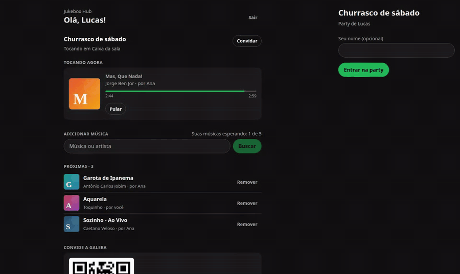
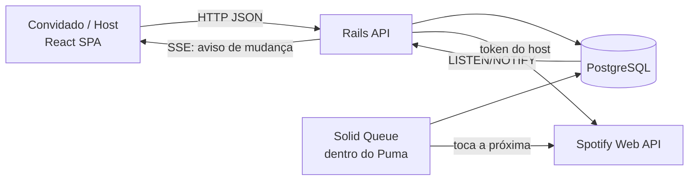

# Jukebox Hub

Jukebox colaborativa integrada ao Spotify: o host toca a música no próprio dispositivo e os convidados de
uma festa escolhem a próxima faixa pelo celular, sem precisar de conta.

[](https://github.com/pablosscosta/jukebox-hub/actions/workflows/ci.yml)
[](LICENSE)


> **Status:** MVP completo e no ar. Os próximos passos estão no [ROADMAP](docs/ROADMAP.md).

## Demonstração


*Demonstração com dados fictícios: a interface é a real, mas a API é simulada e a música não toca de
verdade. Como regravar: [docs/demo](docs/demo/README.md).*

No ar em **[jukebox-hub-web.onrender.com](https://jukebox-hub-web.onrender.com)** (plano gratuito: o primeiro
acesso pode levar até 1 minuto).

Criar parties exige Spotify Premium e, nesta versão de demonstração, uma conta liberada no app do
Spotify (o modo de desenvolvimento do Spotify aceita até 5). Quem não está liberado vê como pedir
acesso. Convidados entram pelo link, sem conta.

**Como uma party funciona:**
1. O host entra com o Spotify, abre o Spotify num dispositivo (notebook, celular, caixa de som) e cria
   a party escolhendo esse dispositivo.
2. Os convidados escaneiam o QR code (ou abrem o link) e entram, só com um nome opcional.
3. Todos buscam músicas e adicionam à fila; a primeira começa sozinha e as próximas entram quando a
   atual acaba, na ordem justa.
4. Mantenha a tela do host aberta durante a festa: ela mantém o servidor gratuito acordado.

> **Quando a fila acaba, a música para** até alguém adicionar outra. A reprodução automática
> (*Autoplay*) do Spotify não ajuda aqui: ela continua a partir de um álbum ou playlist, e a Jukebox Hub
> toca músicas avulsas. Tocar uma playlist de fundo está nos próximos passos.

<p align="center">
  
  &nbsp;
  
</p>

## Funcionalidades
- Host entra com o Spotify (OAuth + PKCE). Os tokens do Spotify ficam criptografados no banco e são
  renovados sozinhos.
- Host com Spotify Premium cria uma party escolhendo o dispositivo onde a música toca (uma party ativa
  por vez).
- Convite por link e QR code; o convidado entra pelo celular, sem login, e recebe um token anônimo.
- Convidados e host buscam músicas no Spotify (com a conta do host) e montam a fila: até 5 músicas
  esperando por pessoa, sem duplicatas, e ninguém toca 3 seguidas se outra pessoa tem música na fila.
- A fila toca sozinha no Spotify do host: a próxima música entra quando a atual acaba, e o host pode
  pular, remover ou tocar uma música direto pelo app do Spotify (ela "fura a fila" e a fila volta depois).
- Fila e música tocando atualizadas ao vivo em todos os celulares (SSE), sem recarregar a página.
- Interface escura pensada para o celular: a música tocando no topo, com capa e barra de progresso.
- O host encerra a party (a música para e os convidados ficam sabendo na hora); sem atividade por 6 h,
  ela encerra sozinha, e os dados são apagados no dia seguinte.
- Publicado no Render gratuito, com a API em Docker; o site avisa quando o servidor está acordando.
- Lint, testes e checagens de segurança rodando no CI; o Render publica a cada merge no `main`.

## Tecnologias
| Tecnologia | Por quê |
| --- | --- |
| Ruby on Rails 8.1 (API) | Convenções fortes e produtividade para uma API REST com regras de negócio |
| PostgreSQL | Regras críticas (ex.: sem duplicatas) garantidas por constraints; `LISTEN/NOTIFY` para tempo real sem Redis |
| Solid Queue | Jobs agendados (avançar a fila) no mesmo Postgres, rodando dentro do Puma: sem Redis nem servidor extra |
| React 19 + TypeScript strict | SPA pensada para celular, com tipos protegendo o contrato com a API |
| Vite | Dev server e build rápidos, sem configuração extra |
| RSpec + FactoryBot + WebMock | Request specs legíveis; Spotify sempre simulado nos testes |
| Vitest + Testing Library | Testes de comportamento do usuário, integrados ao Vite |
| GitHub Actions | CI em todo PR: lint, segurança (Brakeman, bundler-audit) e testes das duas aplicações |
| Render + Docker | Hospedagem gratuita declarada em `render.yaml`; a API roda em Docker porque o Render não garante o Ruby 4.0 |

## Arquitetura


Monorepo com duas aplicações independentes: `backend/` e `frontend/`. A API é a única que fala com o
Spotify, usando o token do host, então os convidados nunca precisam de conta. Um job do Solid Queue
acorda perto do fim de cada música, confere o Spotify e toca a próxima da ordem justa. Cada mudança
gravada dispara um `NOTIFY` no Postgres, e as telas abertas recebem um aviso por SSE e recarregam a
fila. Mais detalhes em [docs/arquitetura.md](docs/arquitetura.md),
[docs/modelo-conceitual.md](docs/modelo-conceitual.md) e [docs/api.md](docs/api.md).

## Como rodar localmente
### Pré-requisitos
- Ruby 4.0.10 (versão em `backend/.ruby-version`; recomendado instalar com [mise](https://mise.jdx.dev/))
- Node.js 24 (`.nvmrc`)
- PostgreSQL 16 rodando localmente

> Use sempre `127.0.0.1` em vez de `localhost`: o Spotify não aceita `localhost` como endereço de
> retorno do login.

### App no Spotify
1. Crie um app em [developer.spotify.com/dashboard](https://developer.spotify.com/dashboard)
   (marque **Web API**).
2. Em **Redirect URIs**, adicione `http://127.0.0.1:3000/auth/spotify/callback`.
3. Em **User Management**, adicione a sua conta do Spotify. Enquanto o app estiver em modo de
   desenvolvimento, só as contas cadastradas ali conseguem logar.
4. Copie o **Client ID** e o **Client Secret** para o `backend/.env` (próximo passo).

### Variáveis de ambiente
Copie `backend/.env.example` para `backend/.env` e preencha. Em dev o arquivo é carregado pelo
`dotenv-rails`.

| Variável | Para quê |
| --- | --- |
| `SPOTIFY_CLIENT_ID` / `SPOTIFY_CLIENT_SECRET` | credenciais do app no Spotify |
| `SPOTIFY_REDIRECT_URI` | `http://127.0.0.1:3000/auth/spotify/callback` em dev |
| `FRONTEND_ORIGIN` | endereço do frontend (padrão `http://127.0.0.1:5173`) |
| `INVITE_ORIGIN` | opcional; base do link de convite. Em dev, o IP do notebook no Wi-Fi para testar com o celular (padrão: `FRONTEND_ORIGIN`) |
| `DATABASE_*` | opcional; por padrão conecta no Postgres local pelo socket Unix, com o seu usuário |

No frontend, `VITE_API_URL` aponta para a API em produção. Em dev ela não é necessária: a página usa a
porta 3000 do mesmo endereço em que foi aberta (veja `frontend/.env.example`).

### Backend
```bash
cd backend
bin/setup --skip-server   # instala as gems e cria o banco
bin/dev                   # http://127.0.0.1:3000 (health check: /up)
```

### Frontend
```bash
cd frontend
npm install
npm run dev               # http://127.0.0.1:5173
```

Abra http://127.0.0.1:5173 e clique em **Entrar com Spotify**.

### Testar com o celular (convidado)
O celular não abre `127.0.0.1` (esse endereço é sempre o próprio aparelho), então o convidado usa o IP
do notebook na rede Wi-Fi:

1. Descubra o IP do notebook: `ip -4 route get 1.1.1.1 | grep -oP 'src \K\S+'` (Linux) ou
   `ipconfig getifaddr en0` (macOS).
2. No `backend/.env`, defina `INVITE_ORIGIN=http://<ip>:5173`.
3. Suba a API escutando na rede: `bin/dev -b 0.0.0.0`. O Vite já escuta na rede.
4. Com o celular no mesmo Wi-Fi, escaneie o QR code da tela do host.

O host continua usando `http://127.0.0.1:5173` no notebook, por causa do login do Spotify. Se o
celular não abrir a página, confira se o firewall libera as portas 3000 e 5173.

## Deploy (Render)
O [`render.yaml`](render.yaml) descreve tudo: a API (Docker), o banco e o site. No plano gratuito a API
dorme sem acessos e o banco expira em 30 dias ([ADR 0009](docs/adr/0009-hospedagem-render.md)).

1. No Render, crie um **Blueprint** a partir deste repositório. Ele cria `jukebox-hub-api`,
   `jukebox-hub-web` e `jukebox-hub-db`.
2. Preencha as variáveis marcadas como secretas:
   - API: `FRONTEND_ORIGIN` (endereço do site), `SPOTIFY_CLIENT_ID`, `SPOTIFY_CLIENT_SECRET` e
     `SPOTIFY_REDIRECT_URI` (`<endereço da API>/auth/spotify/callback`).
   - Site: `VITE_API_URL` (endereço da API) e, opcional, `VITE_CONTACT_EMAIL` (para quem uma conta
     ainda não liberada deve pedir acesso).
3. No painel do Spotify, cadastre a mesma redirect URI e as contas que vão criar parties (até 5).
4. Quando o Render avisar que o banco gratuito vai expirar, crie um novo e atualize o `DATABASE_URL`.

Para testar a imagem da API localmente: `docker build -t jukebox-hub-api backend`.

## Testes
```bash
# backend
cd backend
bundle exec rspec         # testes
bin/rubocop               # lint
bin/ci                    # tudo o que o CI roda (lint, segurança, testes)

# frontend
cd frontend
npm test -- --run         # testes
npm run lint              # ESLint (type-checked)
npm run format:check      # Prettier
```

Os testes cobrem o login completo com o Spotify simulado pelo WebMock: troca do código, `state`
inválido, PKCE, código de uso único, renovação e revogação de tokens; a criação da party (Premium,
uma ativa por host, device disponível); a entrada do convidado; a fila (busca, limite de 5, sem
duplicatas, ordem justa testada por cenários); o playback (avanço pelo job, pausa, música do host pelo
Spotify, cliques repetidos e jobs atrasados que não pulam músicas a mais); e o tempo real e o ciclo de
vida (avisos SSE, encerrar, expirar e apagar parties). No frontend, as telas de início, de retorno do
login, do host e do convidado, incluindo busca, fila ao vivo e controles do host. Cada funcionalidade
do MVP entra com seus testes.

## Decisões e aprendizados
- **Ordem da fila calculada, não salva**: até 5 músicas esperando por pessoa e ninguém toca 3 seguidas
  se outra pessoa tem música na fila. Uma função pura decide a ordem a cada leitura, então não há
  posições para manter em sincronia. ([ADR 0007](docs/adr/0007-fila-justa.md))
- **Avanço por job que confere o Spotify**: o Spotify não avisa quando a música acaba nem quando o host
  toca outra coisa pelo app. Um job acorda perto do fim e pergunta antes de agir (~2 chamadas por
  música); cliques repetidos e jobs atrasados não pulam músicas a mais. ([ADR 0008](docs/adr/0008-avanco-da-fila.md))
- **SSE com aviso sem dados**: o stream só diz "mudou" e a tela busca a fila pela API, então o token
  nunca vai na URL. Um único `LISTEN` por processo, com conexão própria, evita uma conexão do banco por
  celular. Aprendizado: o `ActionController::Live` dividia a conexão do banco entre duas threads e
  travava o servidor; o stream virou um corpo de resposta que nunca toca no banco.
  ([ADR 0004](docs/adr/0004-sse-com-postgres-listen-notify.md))
- **Login no backend + token Bearer**: o client secret e os tokens do Spotify nunca vão ao navegador, e
  o frontend usa um token próprio da API, sem cookies entre domínios.
  ([ADR 0006](docs/adr/0006-autenticacao-do-host.md))
- **Hospedagem gratuita com limites assumidos**: Render com a API em Docker e o Solid Queue em modo
  `async` para caber em 512 MB; a API dorme sem acessos e o banco expira em 30 dias, o que combina com
  a party efêmera. ([ADR 0009](docs/adr/0009-hospedagem-render.md), [ADR 0002](docs/adr/0002-postgresql-party-efemera.md))

Outras decisões em [`docs/adr/`](docs/adr/): monorepo, nomes `Party`/`Participant`, RSpec + FactoryBot.
O TypeScript fica fixo na 6.0 porque o `typescript-eslint` ainda não suporta o TS 7.

## Próximos passos
Fora do MVP ([ROADMAP](docs/ROADMAP.md)):
- **Playlist de fundo**: quando a fila acaba, tocar uma playlist escolhida pelo host até alguém
  adicionar uma música.
- Pedido de acesso de hosts, botões "Tocar a seguir/agora" para o host e transição sem silêncio entre
  músicas.
- Votação para pular faixa, histórico de parties e rate limiting por convidado.
- Um servidor que não dorme, se o app crescer (a imagem Docker já serve para isso).

## Autor
**Pablo Costa**
- LinkedIn: [linkedin.com/in/pablosilva013](https://www.linkedin.com/in/pablosilva013)
- GitHub: [github.com/pablosscosta](https://github.com/pablosscosta)
- Portfólio: [portfolio-pablosscosta.netlify.app](https://portfolio-pablosscosta.netlify.app/)
