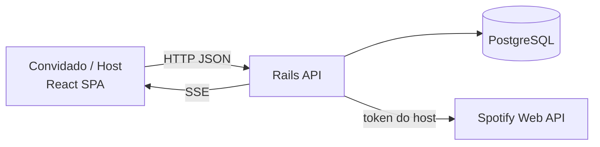

# Jukebox Hub

Jukebox colaborativa integrada ao Spotify: o host toca a música no próprio dispositivo e os convidados de
uma festa escolhem a próxima faixa pelo celular, sem precisar de conta.

[](https://github.com/pablosscosta/jukebox-hub/actions/workflows/ci.yml)
[](LICENSE)


> **Status:** reescrita (v2) em andamento. A base do projeto está pronta e as funcionalidades do MVP
> estão sendo implementadas uma a uma ([ROADMAP](docs/ROADMAP.md)). A versão anterior está na tag
> `v0-legado`.

## Demonstração
> **TODO:** adicionar o link do deploy no Render e um GIF do fluxo (host cria a party → convidado
> adiciona uma música) em `docs/assets/`.

## Funcionalidades
Já funciona:
- Host entra com o Spotify (OAuth + PKCE). Os tokens do Spotify ficam criptografados no banco e são
  renovados sozinhos.
- Lint, testes e checagens de segurança rodando no CI.

Planejado para o MVP ([ROADMAP](docs/ROADMAP.md)):
- Host cria uma party ligada a um dispositivo do Spotify.
- Convite por link e QR code; convidado entra sem login.
- Fila FIFO sem músicas duplicadas e com no máximo 2 músicas seguidas por convidado.
- Avanço automático de faixa controlado pelo backend; só o host pula, remove ou encerra.
- Fila e faixa atual atualizadas ao vivo via SSE.

## Tecnologias
| Tecnologia | Por quê |
| --- | --- |
| Ruby on Rails 8.1 (API) | Convenções fortes e produtividade para uma API REST com regras de negócio |
| PostgreSQL | Regras críticas (ex.: sem duplicatas) garantidas por constraints; `LISTEN/NOTIFY` para tempo real sem Redis |
| React 19 + TypeScript strict | SPA pensada para celular, com tipos protegendo o contrato com a API |
| Vite | Dev server e build rápidos, sem configuração extra |
| RSpec + FactoryBot + WebMock | Request specs legíveis; Spotify sempre simulado nos testes |
| Vitest + Testing Library | Testes de comportamento do usuário, integrados ao Vite |
| GitHub Actions + Render | CI em todo PR; deploy de API, banco e site estático declarado em `render.yaml` |

## Arquitetura


Monorepo com duas aplicações independentes: `backend/` e `frontend/`. A API é a única que fala com o
Spotify, usando o token do host, então os convidados nunca precisam de conta. Os eventos de fila e
playback chegam aos navegadores por SSE e são distribuídos entre processos pelo `LISTEN/NOTIFY` do
Postgres. Mais detalhes em [docs/arquitetura.md](docs/arquitetura.md),
[docs/modelo-conceitual.md](docs/modelo-conceitual.md) e [docs/api.md](docs/api.md).

## Como rodar localmente
### Pré-requisitos
- Ruby 4.0.10 (versão em `backend/.ruby-version`; recomendado instalar com [mise](https://mise.jdx.dev/))
- Node.js 24 (`.nvmrc`)
- PostgreSQL 16 rodando localmente

> Use sempre `127.0.0.1` em vez de `localhost`: o Spotify não aceita `localhost` como endereço de
> retorno do login.

### App no Spotify
1. Crie um app em [developer.spotify.com/dashboard](https://developer.spotify.com/dashboard)
   (marque **Web API**).
2. Em **Redirect URIs**, adicione `http://127.0.0.1:3000/auth/spotify/callback`.
3. Em **User Management**, adicione a sua conta do Spotify. Enquanto o app estiver em modo de
   desenvolvimento, só as contas cadastradas ali conseguem logar.
4. Copie o **Client ID** e o **Client Secret** para o `backend/.env` (próximo passo).

### Variáveis de ambiente
Copie `backend/.env.example` para `backend/.env` e preencha. Em dev o arquivo é carregado pelo
`dotenv-rails`.

| Variável | Para quê |
| --- | --- |
| `SPOTIFY_CLIENT_ID` / `SPOTIFY_CLIENT_SECRET` | credenciais do app no Spotify |
| `SPOTIFY_REDIRECT_URI` | `http://127.0.0.1:3000/auth/spotify/callback` em dev |
| `FRONTEND_ORIGIN` | endereço do frontend (padrão `http://127.0.0.1:5173`) |
| `DATABASE_*` | opcional; por padrão conecta no Postgres local pelo socket Unix, com o seu usuário |

No frontend, `VITE_API_URL` aponta para a API (padrão `http://127.0.0.1:3000`; veja
`frontend/.env.example`).

### Backend
```bash
cd backend
bin/setup --skip-server   # instala as gems e cria o banco
bin/dev                   # http://127.0.0.1:3000 (health check: /up)
```

### Frontend
```bash
cd frontend
npm install
npm run dev               # http://127.0.0.1:5173
```

Abra http://127.0.0.1:5173 e clique em **Entrar com Spotify**.

## Testes
```bash
# backend
cd backend
bundle exec rspec         # testes
bin/rubocop               # lint
bin/ci                    # tudo o que o CI roda (lint, segurança, testes)

# frontend
cd frontend
npm test -- --run         # testes
npm run lint              # ESLint (type-checked)
npm run format:check      # Prettier
```

Os testes cobrem o login completo com o Spotify simulado pelo WebMock: troca do código, `state`
inválido, PKCE, código de uso único, renovação e revogação de tokens. No frontend, as telas de
início, de retorno do login e do host. Cada funcionalidade do MVP entra com seus testes.

## Decisões e aprendizados
- **Postgres em vez de sessões em memória**: o Puma roda vários processos que não dividem memória.
  "Party efêmera" virou regra de expiração. ([ADR 0002](docs/adr/0002-postgresql-party-efemera.md))
- **`Party` e `Participant`**: evitam conflito com a sessão HTTP do Rails e com o model `Session` do
  gerador de autenticação. ([ADR 0003](docs/adr/0003-nomes-party-participant.md))
- **SSE em vez de WebSocket**: a comunicação em tempo real é só do servidor para o cliente.
  ([ADR 0004](docs/adr/0004-sse-com-postgres-listen-notify.md))
- **Login no backend + token Bearer**: o client secret e os tokens do Spotify nunca vão ao navegador, e
  o frontend usa um token próprio da API, sem cookies entre domínios.
  ([ADR 0006](docs/adr/0006-autenticacao-do-host.md))
- **Monorepo**: API e tela que a consome mudam no mesmo PR. ([ADR 0001](docs/adr/0001-monorepo.md))
- **TypeScript 6.0 fixo**: o `typescript-eslint` ainda não suporta o TS 7.

## Próximos passos
Fora do MVP: votação para pular faixa, busca com cache, histórico de parties, rate limiting por
convidado e deploy contínuo.

## Autor
**Pablo Costa**
- LinkedIn: [linkedin.com/in/pablosilva013](https://www.linkedin.com/in/pablosilva013)
- GitHub: [github.com/pablosscosta](https://github.com/pablosscosta)
- Portfólio: [portfolio-pablosscosta.netlify.app](https://portfolio-pablosscosta.netlify.app/)
